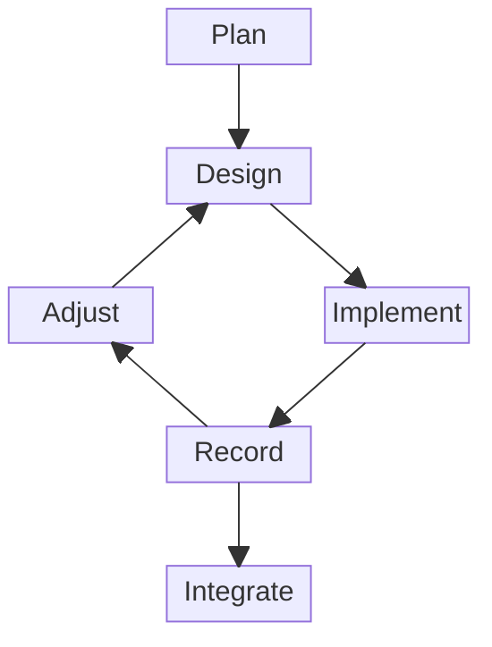

# Contributing

These guidelines only describe what no tool checks: the conventions enforced by configuration files or by the checks of pull requests are not restated, and the messages of the checks explain how to fix failures.
AI agents also follow [`AGENTS.md`](AGENTS.md).

## Principles

These principles guide every contribution:

- Keep every decision auditable: record its rationale once, where it belongs (the RFC for a design decision, the commit message for a change), and link to it elsewhere.
- Before adopting a new approach, check how established projects solve the same problem.
- Cite the source of every claim about other work (papers, documentation, languages, projects) with a link on its name in the text, so that it can be checked.
- Keep everything consistent: file layout, naming, wording and terms.
  When a convention or a term changes, apply it everywhere it is used in the same change.
- Never choose a solution that increases debt of any kind: technical, documentation, consistency or process.
  The extra work a better solution requires is not a reason to settle for a worse one.
  When some debt cannot be avoided, make it explicit in an issue.
- Favor the default configuration of tools and widely established conventions; only deviate from them with a clear reason, documented where the deviation is made.

## Style

Every text of the repository follows this style:

- Write in US English: documentation, comments, commit messages, issues and pull requests.
- In Markdown files, write one sentence per line, without wrapping lines at a fixed length, so that editing a sentence only changes its own line.
  A sentence too long to read on one line is probably too long.
- Give every section of a Markdown file, whatever its level, at least one sentence of its own before its first subsection, which tells what the section holds.
- Introduce every list, table and figure with a sentence before it.
- Sort alphabetically the lists whose order has no meaning.
- Start the README with one short sentence saying what the repository is, and copy it verbatim as the description of the repository on GitHub.

## Workflow

Work on a subject starts with Plan, then goes through iterations that each design, implement, record and adjust a part of it, and Integrate takes what an iteration records.

The steps outside the repositories are free, and those inside them are constrained:

- Plan, Design and Adjust happen outside the repositories, in whatever way suits the contributors, alone or in a group, with or without tools.
  - Plan is a good time to get an overall view of the subject: its scope, its risks and their countermeasures, its decisive problems and their possible solutions.
    The academic literature, the practice of other projects, experiments and prototypes can help, and writing them down helps more than keeping them in mind.
  - Design can do the same for one iteration, sized to be easy to review, with the aim of deciding rather than exploring what is possible.
  - Adjust is the moment to revise the plan, from the results, the problems and the solutions of the iteration, and to rethink it when the iterations do not fit together.
- Implement, Record and Integrate happen in the repositories, through pull requests that follow this guide and pass the checks.
  Every pull request is opened as a draft and stays one until Integrate.
  - Implement changes one or more repositories, with one pull request per repository, but no RFC.
  - Record writes in an [RFC](#rfcs) what the implementation of the iteration confirmed, and only that iteration.
    Except to fix an RFC, implement first.
    An iteration may have nothing to record, which is fine: the point is to ask whether it has.
  - Integrate starts when the submitter judges a pull request ready, and only then: they mark it ready for review and ask an integrator to review and merge it.
    When the integrator asks for changes, the submitter adds them to the pull request; when the integrator judges it not relevant to the project, it is closed.

Contributors may use AI or any other tool to prepare their pull requests, and bear full responsibility for what they submit, whatever tools they used.
Only an integrator decides to integrate a pull request, never an AI or a tool, which may assist them and perform the merge they decided; the integrator bears full responsibility for accepting or rejecting it.

## RFCs

An RFC records what an iteration confirmed, at its Record step, and is created and changed by these rules.

### Creating an RFC

An RFC is created in four steps:

1. Copy [`0000-template.md`](0000-template.md) to `text/0000-short-name.md` and fill it in.
2. Open a pull request: the RFC is discussed in it.
3. Rename the file after the number of the pull request, on four digits (`text/0042-short-name.md`), and link the pull request in its header.
4. The pull request is merged if the RFC is accepted, and closed if it is rejected.

### Changing an Accepted RFC

An accepted RFC is never deleted nor renumbered, and only receives very minor amendments, such as fixing a typo.
A substantial change is a new RFC, which supersedes the old one: a note is added at the top of the old RFC, linking to the new one.

## Pull Requests

Pull requests follow these rules:

- The merge queue merges a pull request with a merge commit once its merge with `main` passes the checks, and the commits it brings are exactly the ones that were reviewed.
- Never rewrite the history of a pull request once pushed: make every change, including those asked by the review, a new commit, meaningful on its own, so that the review stays readable.
- A pull request needs no update from `main`, since the merge queue checks its merge with `main`.
  When it conflicts with `main`, merge `main` into it (`git merge --signoff origin/main`) and resolve the conflict in that merge commit.

## Development Environment

Install [Nix](https://nixos.org/), with flakes enabled, on Linux (x86_64 or aarch64) or macOS (Apple silicon).
`nix develop` provides every tool the checks use, at the versions of the nixpkgs commit pinned by `flake.lock`.
With [direnv](https://direnv.net/), `.envrc` loads it when entering the repository, once allowed with `direnv allow` after reading it.

`nix run '.#build-book'` builds into `book/` the book published by GitHub Pages, to read it as it will be published, from `book/index.html`.

For VS Code, `nix run '.#setup-vscode'` writes the recommended extensions and settings to `.vscode/`, which git ignores: the files are then yours to customize.

## Checks

`nix run '.#check'` runs every check of the pull requests, and `nix run '.#check-<name>'` one of them, such as `nix run '.#check-reuse'`.

## Developer Certificate of Origin

By signing off a commit, you certify that you have the right to submit it under the license of the repository, as described by the [Developer Certificate of Origin 1.1](https://developercertificate.org/).

Trailers end the commit message, sorted alphabetically (e.g. `Co-Authored-By`, then `Signed-off-by`): write the other trailers at the end of the message, and let `git commit -s` add the sign-off after them.
