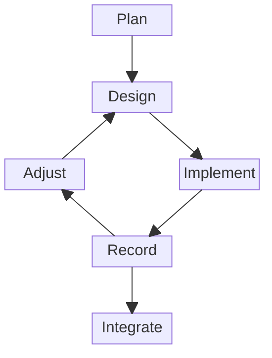

# RFC 0039: Workflow

Pull request: [sic-lang/rfcs#39](https://github.com/sic-lang/rfcs/pull/39)

## Summary

Work on a subject of the project starts with a plan, then goes through iterations that each design, implement, record and adjust a part of it, and only what an iteration records is integrated.
The steps outside the repositories are free, and those inside them are constrained: an RFC records only what an implementation confirmed, a pull request keeps the history that was reviewed and stays a draft until an integrator decides to merge it, and every contributor bears full responsibility for their work, whatever tools they used.

## Motivation

A design written before it is implemented states what its authors expect, not what holds: the implementation finds the cases the design missed, and the RFC must then change after its review, or be superseded.
The project also needs a process that does not depend on who contributes, one person or many, with or without AI, and that says who answers for a contribution and who decides to accept it.
Finally, a review only protects the project if what is merged is exactly what was reviewed, and if the history of the review stays readable.

## Proposal

The proposal has three parts: the steps of the workflow, the responsibilities of the contributors, and the rules of the pull requests.
Each repository states them in its `CONTRIBUTING.md`, which this RFC does not replace: it records why they were chosen.

### Steps

Work on a subject starts with Plan, then goes through iterations that each go through Design, Implement, Record and Adjust, and Integrate takes what an iteration records.

Each step has its own purpose:

- Plan takes an overall view of the subject: its scope, its risks and their countermeasures, its decisive problems and their possible solutions.
- Design does the same for one iteration, sized to be easy to review, with the aim of deciding rather than exploring what is possible.
- Implement changes one or more repositories, with one pull request per repository, but no RFC.
- Record writes in an RFC what the implementation of the iteration confirmed, and only that iteration; an iteration may have nothing to record.
- Adjust revises the plan from the results, the problems and the solutions of the iteration, and rethinks it when the iterations do not fit together.
- Integrate merges the pull requests of an iteration, once their submitter judges them ready and an integrator decides it.

Plan, Design and Adjust happen outside the repositories, in whatever way suits the contributors, alone or in a group, with or without tools.
Implement, Record and Integrate happen in the repositories, through pull requests that follow the rules of each repository and pass its checks.
Except to fix an RFC, an iteration implements before it records.

### Responsibilities

Contributors may use AI or any other tool to prepare their pull requests, and bear full responsibility for what they submit, whatever tools they used.
Only an integrator decides to integrate a pull request, never an AI or a tool, which may assist them and perform the merge they decided; the integrator bears full responsibility for accepting or rejecting it.

### Pull Requests

The pull requests follow three rules:

- Every pull request is opened as a draft and stays one until Integrate, when the submitter marks it ready for review and asks an integrator to review and merge it.
- The history of a pull request is never rewritten once pushed: every change, including those asked by the review, is a new commit, meaningful on its own.
- A merge queue merges a pull request with a merge commit once its merge with `main` passes the checks, so a pull request needs no update from `main`.
  When it conflicts with `main`, its submitter merges `main` into it and resolves the conflict in that merge commit.

## Drawbacks

The proposal has three drawbacks:

- The pull requests of an iteration stay open until its Record is written, so they may conflict with `main` for longer.
- Without rewriting, `main` keeps every commit of a review, including those that fix earlier ones, and only the merge commits are known to pass the checks.
- Nothing forces a pull request to be opened as a draft: the rule relies on its submitter.

## Rationale and Alternatives

Each part of the proposal answers one of the problems of the motivation, and the alternatives below were weighed against it.

### Recording After Implementing

The common alternative writes the RFC first, and implements it once accepted.
It lets a design be rejected before any work on its implementation, but the RFC then records what was expected, and every case the implementation finds changes an accepted text.
A design can still be reviewed before its implementation, when the free steps organize such a review.
Implementing first makes the RFC record what an implementation confirmed, whether code, a proof or a configuration, and keeps the RFC short, since it records one iteration only.

### Free and Constrained Steps

A process could prescribe every step, such as discussing each design in an issue.
It would make every step auditable, but it would constrain how contributors think and explore, for no gain to the project: a plan or a design matters through what it produces, and that is what the repositories review.
The constraints apply where work becomes shared: the pull requests, their checks and their review.

### Accountability

A project may forbid AI, or let tools act on their own.
Forbidding AI cannot be checked and excludes useful tools, while letting a tool decide leaves no one to answer for the decision.
Making the submitter and the integrator answer for their work, whatever tools they used, keeps a person accountable for every step, without assuming who the contributors are or which tools they use.

### History of Pull Requests

The alternative rewrites the history of a pull request during review, with fixup commits squashed before merging, or a new version of the series.
It gives `main` a clean history, but the review loses the link between the comments and the commits they were made on, and the merged commits are not the ones that were reviewed.
New commits keep the review readable, and a merge commit brings exactly the reviewed commits into `main`.

### Merge Queue

Requiring a pull request to be up to date with `main` also checks its merge before merging, but asks its submitter to update it from `main` after every merge, which adds a merge commit of `main` or a rewrite each time.
A merge queue checks the merge with `main` itself, so a pull request is only updated when it conflicts.

### Drafts

A label or a check could also mark a pull request as not yet ready.
A draft needs no configuration, and GitHub cannot merge it ([About pull requests](https://docs.github.com/en/pull-requests/collaborating-with-pull-requests/proposing-changes-to-your-work-with-pull-requests/about-pull-requests)), so the tool itself keeps a pull request from being merged before Integrate.

## Prior Art

Established projects take various positions on each part of the proposal:

- The [Rust RFC process](https://github.com/rust-lang/rfcs#readme) accepts an RFC before its implementation, and asks not to squash or rebase the commits of an RFC pull request once they are visible.
- [PEP 1](https://peps.python.org/pep-0001/) of Python accepts a PEP before its reference implementation, but requires that implementation before the PEP becomes final.
- [LLVM](https://llvm.org/docs/GitHub.html) asks for new commits rather than force-pushes during review, and squashes the pull request when merging.
- The [AI tool policy of LLVM](https://llvm.org/docs/AIToolPolicy.html) makes the contributor fully accountable for their contributions, requires a human in the loop, and bans agents that take action without human approval.
- The [Linux kernel](https://docs.kernel.org/process/submitting-patches.html) reviews patch series that are sent again as new versions, and its [guidance on coding assistants](https://docs.kernel.org/process/coding-assistants.html) forbids AI agents to add the sign-off, leaving the human submitter fully responsible.
- The [merge queue of GitHub](https://docs.github.com/en/repositories/configuring-branches-and-merges-in-your-repository/configuring-pull-request-merges/managing-a-merge-queue) checks a pull request against the latest `main` and the pull requests ahead of it, without requiring its submitter to update it.

## Unresolved Questions

None.
